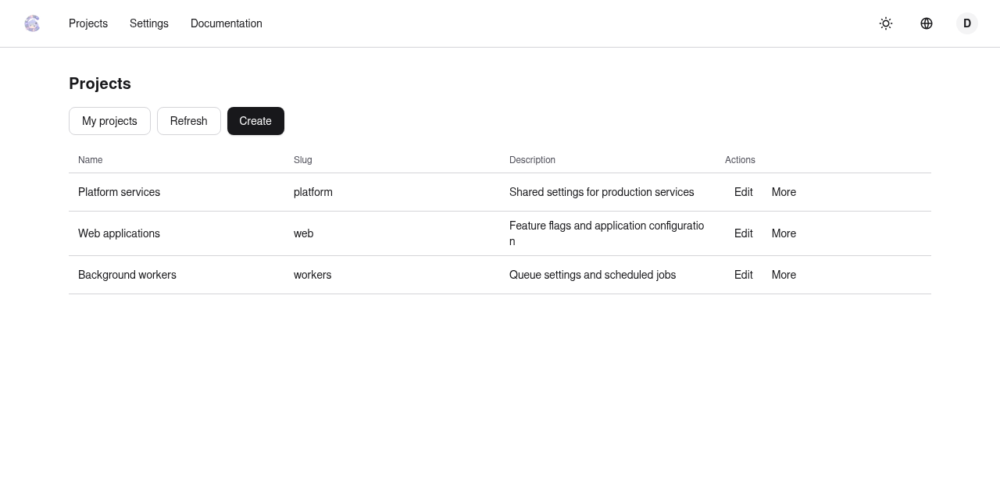

<p align="center">
  
</p>
<h3 align="center">ConfigCenter</h3>
<p align="center">A self-hosted configuration service with project isolation, scoped API keys and an agent-ready MCP endpoint.</p>

<p align="center">
  <a href="README.md">English</a> · <a href="README_zh.md">简体中文</a>
</p>

<p align="center">
  <a href="docs/index.md">Documentation</a> · <a href="#quick-start">Deployment</a> · <a href="docs/guide.md#configuration">Environment variables</a> · <a href="docs/api.md">HTTP API</a>
</p>

<p align="center">
  <a href="https://github.com/OXeu/configcenter/actions/workflows/ci.yml"></a>
  <a href="go.mod"></a>
  <a href="package.json"></a>
  <a href="LICENSE"></a>
</p>

## Preview



Project management in the actual web UI, rendered with synthetic example data.

## Features

- Projects, environments, configuration items and reviewed change proposals.
- OAuth sign-in and API keys scoped by project and operation.
- REST, a Go SDK and MCP for application and agent integration.
- English/Chinese UI, light/dark themes, SQLite or MySQL, and an embedded frontend.

## Quick Start

Install Git, Make, Node.js 24.15+ with npm, and Go 1.26.10. Bootstrap also needs Git access to the pinned [center-common](https://github.com/OXeu/center-common) repository.

```sh
git clone https://github.com/OXeu/configcenter.git
cd configcenter
make bootstrap
make build
CC_DB=file:.tmp/configcenter.db ./.tmp/bin/configcenter
```

Open http://127.0.0.1:8080. This starts a local SQLite instance; sign-in remains disabled until an OAuth provider is configured.

### Enable sign-in

1. Create an OAuth application at your identity provider with callback `http://127.0.0.1:8080/oauth/callback`.
2. Set `CC_OAUTH_ISSUER`, `CC_OAUTH_CLIENT_ID` and `CC_OAUTH_CLIENT_SECRET` in an ignored `.env.local`.
3. Set `CC_BOOTSTRAP_ADMIN_EMAIL` to the intended administrator’s verified email before the first database initialization.
4. Set `CC_PUBLIC_URL` to the deployed public address when deploying beyond localhost.
5. Restart the binary to apply the configuration.

### Load settings from ConfigCenter

Set `CC_CONFIGCENTER_URL`, `CC_CONFIGCENTER_API_KEY` and optionally `CC_CONFIGCENTER_ENVIRONMENT` in the process environment or `.env.local`. The bundled Go SDK reads runtime `CC_*` settings from the key's project, including OAuth settings such as `CC_OAUTH_ISSUER=https://auth.xeu.life`.

Remote values override local settings. Missing keys fall back to process variables, `.env.local` and defaults; remote failures warn and use local settings so the service can bootstrap itself. See [configuration](docs/guide.md#configuration) for permissions and startup behavior.

### Production and development

The [deployment and configuration guide](docs/guide.md) retains the full environment table, MySQL and Tencent SCF instructions, API/SDK overview and development workflow. Run `make check` with golangci-lint installed before shipping. Generated assets and binaries stay in `.tmp/`; the production binary serves the UI without Node.js.

## Star History

[](https://www.star-history.com/#OXeu/configcenter&Date)

## LICENSE

Licensed under the [Apache License 2.0](LICENSE).
