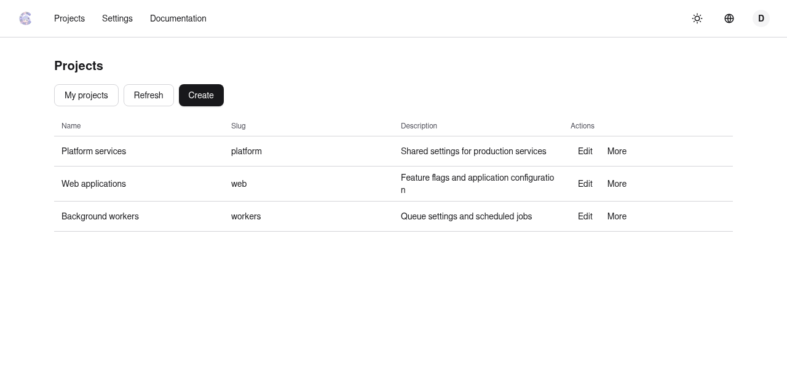

<p align="center">
  
</p>
<h3 align="center">ConfigCenter</h3>
<p align="center">提供项目隔离、细粒度 API 密钥和 MCP 接口的自托管配置中心。</p>

<p align="center">
  <a href="README.md">English</a> · <a href="README_zh.md">简体中文</a>
</p>

<p align="center">
  <a href="docs/index.md">使用文档</a> · <a href="#快速开始">部署</a> · <a href="docs/guide.md#configuration">环境变量</a> · <a href="docs/api.md">HTTP API</a>
</p>

<p align="center">
  <a href="https://github.com/OXeu/configcenter/actions/workflows/ci.yml"></a>
  <a href="go.mod"></a>
  <a href="package.json"></a>
  <a href="LICENSE"></a>
</p>

## 预览



项目管理界面，使用实际前端与示例数据渲染。

## 功能

- 项目、环境、配置项和变更提案审核。
- OAuth 登录与按项目、操作授权的 API 密钥。
- REST、Go SDK 和 MCP，方便应用与 Agent 接入。
- 中英文界面、深浅主题、SQLite / MySQL 和嵌入式前端。

## 快速开始

需要 Git、Make、带 npm 的 Node.js 24.15+ 和 Go 1.26.10；引导过程还需要锁定的 [center-common](https://github.com/OXeu/center-common) 仓库的 Git 读取权限。

```sh
git clone https://github.com/OXeu/configcenter.git
cd configcenter
make bootstrap
make build
CC_DB=file:.tmp/configcenter.db ./.tmp/bin/configcenter
```

打开 http://127.0.0.1:8080。以上命令使用本地 SQLite；配置 OAuth 身份提供商后才能登录。

### 启用登录

在身份提供商创建 OAuth 应用，回调地址填写 `http://127.0.0.1:8080/oauth/callback`。将 `CC_OAUTH_ISSUER`、`CC_OAUTH_CLIENT_ID`、`CC_OAUTH_CLIENT_SECRET` 写入被忽略的 `.env.local`，然后重启程序。首次初始化数据库前，将 `CC_BOOTSTRAP_ADMIN_EMAIL` 设为目标管理员已验证的邮箱。部署到公网时设置 `CC_PUBLIC_URL`。

### 生产部署与开发

完整环境变量表、MySQL、腾讯 SCF、API/SDK 和开发流程保留在[部署与配置指南](docs/guide.md)中。发布前安装 golangci-lint 并运行 `make check`。资源和二进制均生成到 `.tmp/`；生产二进制直接提供界面，无需 Node.js。

## Star History

[](https://www.star-history.com/#OXeu/configcenter&Date)

## LICENSE

本项目采用 [Apache License 2.0](LICENSE) 开源协议。
